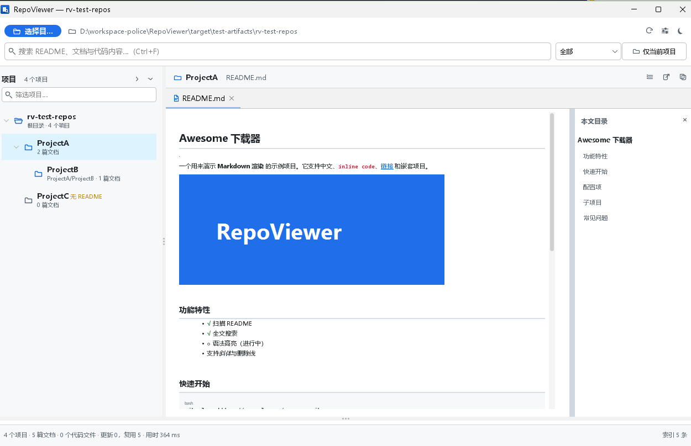
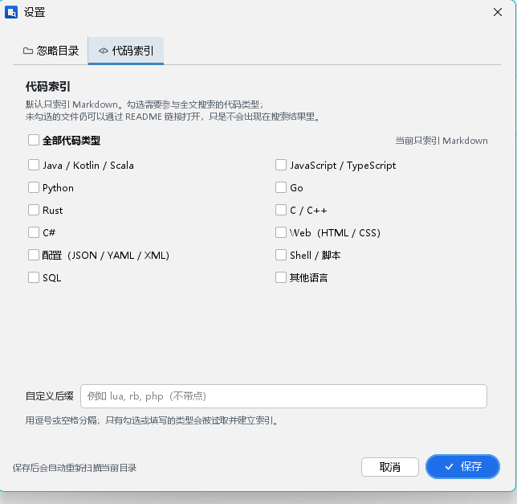

<p align="right"><b>English</b> | <a href="README.zh-CN.md">简体中文</a></p>

# RepoViewer

Turn the repositories scattered across your local disk into a bookshelf you can browse like GitHub.

Pick a directory → RepoViewer discovers every project that contains a `README.md` (nested projects included) → browse projects in the left tree, read Markdown on the right, and search documents and code from the top bar.

Markdown is indexed by default. To search code, open Settings and tick Java, JavaScript, Python, Go, Rust, C++, etc.; saving automatically rescans the current directory.



<sub>First-run welcome screen: `docs/screenshot-welcome.png`</sub>

## Features

### Project discovery

- Recursive scan; skips `node_modules`, `target`, `build`, `dist`, `.git`, `.svn`, `vendor`, `__pycache__`, etc. by default. The ignore list is fully editable in Settings.
- A directory containing `README.md` (case-insensitive; `readme.markdown` is also supported) is treated as a project.
- Directories without a README but with build markers such as `pom.xml`, `package.json`, `go.mod`, or `.git` are kept and marked "No README".
- Nested projects are preserved: project B inside project A becomes a child node of A.
- Files belong to their nearest ancestor project; READMEs inside `node_modules` are not picked up.

### GitHub-style Markdown reading

- commonmark + GFM tables, strikethrough, autolinks, and task lists.
- Pure Java rendering (commonmark → Swing HTML; no webview or browser runtime).
- On Windows, LCD subpixel antialiasing is enabled and fractional metrics are disabled in both Markdown and code views for crisper small text.
- An outline is generated on the right and can be clicked to jump; headings expose both `h-N` and GitHub-style slug anchors.
- Code blocks have a background and language label; tables, blockquotes, and task lists have dedicated styles.
- Relative links, in-page anchors, and local images (automatically scaled to the content width) work directly.
- Light and dark themes, applied to both the Markdown reader and the code viewer.

### Full-text search

- Lucene incremental index: unchanged files are skipped by fingerprint, so repeated scans are fast.
- Chinese uses case-insensitive substring matching without tokenization; English supports multi-term AND; leading and trailing punctuation in query terms is ignored.
- Supports `*` and `?` wildcards.
- Scope: All / Markdown / Code. When code indexing is off, the scope reads "Code (disabled)".
- Markdown is the only indexed type by default; enable code types in Settings first.
- A "By project" dropdown above the results lists **every matched project and its hit count**, even beyond the file-result limit. Selecting a project filters the list; README hits are ranked first.
- Clicking a search result or choosing a project from that dropdown automatically expands and selects the matching project in the left tree.
- Optional "current project only" scope (includes subprojects).
- Results show file name, project, relative path, line number, and a highlighted content snippet.
- Single-click previews; double-click pins the file. Every match in the document is highlighted in yellow and scrolled into view.

### Settings

- Open with the gear button in the toolbar or `Ctrl+,`.
- **Ignored directories**: defaults include `node_modules`, `dist`, `.git`, `.svn`, and other common folders. Add, remove, or restore defaults; hidden directories (starting with `.`) can be toggled separately.
- **Project depth**: by default, only README directories within 4 levels of the scan root become project nodes. Deeper READMEs still count as documents of their parent project and remain searchable. Lower this value for very large download folders.
- **Code indexing**: Markdown only by default. Tick language groups (Java / JavaScript / Python / Go / Rust / C++ / C# ...) or enter custom extensions. Only the selected or entered types are read, counted, and indexed.
- Saving automatically rescans the current directory and removes index entries that are no longer needed.



### Browsing experience

- Two-line project tree: project name plus relative path / document count. Filter by name or path; expand or collapse all.
- Custom-painted tree renderer. For large trees, only the root expands initially, and "Expand all" asks for confirmation.
- Single-click project preview is debounced, so fast arrow-key navigation does not repeatedly render READMEs.
- Preview vs. pinned tabs: a single click uses one preview tab; double-click or a search result opens a pinned tab.
- Resizable document / search-results split.
- Remembers the last directory, window bounds, theme, and divider position.
- Shortcuts: `Ctrl+O` open directory, `F5` rescan, `Ctrl+F` search, `Ctrl+,` settings, `Ctrl+W` close tab, `Ctrl+1/2/3` switch search scope, `Esc` clear search.

## Run

Requires JDK 21+ and Maven 3.9+.

```bat
mvn clean package
java -jar target\RepoViewer.jar
```

Or double-click `run.bat` (it builds automatically when the jar is missing). You can also pass a directory:

```bat
java -jar target\RepoViewer.jar D:\workspace
```

## Automated release

`.github/workflows/release.yml` builds all distributables and publishes them to a GitHub Release:

- Windows portable `.zip` (jpackage `app-image` with a bundled JRE; unzip and run `RepoViewer.exe`)
- Windows `.exe` installer with a bundled JRE
- Linux `.deb` and `.rpm` packages with a bundled JRE
- macOS `.dmg` with a bundled JRE for Apple Silicon and Intel (unsigned; right-click → Open on first launch)
- `RepoViewer-<version>.jar` without a JRE (requires Java 21+)

Run it from **Actions → Release → Run workflow** with a numeric version (for example `1.0.0`), or push a tag such as `v1.0.0`. The workflow runs the tests, builds the shaded jar, creates the platform installers, and creates or updates the release `v<version>`.

The bundled runtime is minimized by default: `jdeps` detects the modules the shaded jar needs, plus `jdk.charsets` (GB18030) and `jdk.crypto.ec` (TLS). Choose the `full` runtime option when dispatching to include all Java SE modules and common JDK modules instead.

Windows binary metadata comes from the package job's `VENDOR`, `DESCRIPTION`, and `COPYRIGHT` environment variables; `--app-version` (2–4 numeric components) is written to both `FileVersion` and `ProductVersion`. jpackage cannot set those two versions independently. Current values: vendor `RepoViewer`, description "Browse local repositories and search Markdown/code", copyright "Copyright 2026 RepoViewer".

## Application icon

The installers use platform-specific icons, passed to jpackage with `--icon`:

| Platform | Path | Format |
| --- | --- | --- |
| Windows | `src/main/resources/icon/icon.ico` | ICO (contains 16–256 px entries) |
| macOS | `src/main/resources/icon/icon.icns` | ICNS |
| Linux | `src/main/resources/icon/icon.png` | PNG, 1024×1024 |

Replace these three files with your own artwork. The Swing window icon is drawn separately at runtime by `UiKit.appImage`.

## Project layout

```
src/main/java/com/repoviewer/
├── RepoViewerApp.java          Entry point: theme, window, restore last directory
├── AppSettings.java            Preferences (last root, theme, window, ignores, depth, code types)
├── core/
│   ├── FileTypes.java          Extensions, default ignored dirs, encoding detection, binary checks
│   ├── RepoProject.java        Project model (parent/children, documents/code, README summary)
│   ├── ProjectScanner.java     Directory scan and project detection (ignores, code types, depth)
│   ├── MarkdownRenderer.java   Markdown → Swing HTML (anchors, code blocks, links, images)
│   └── RepoIndex.java          Lucene incremental index, search, snippets, project aggregation
└── ui/
    ├── MainFrame.java          Main window: scan flow, search scheduling, shortcuts, theme
    ├── SettingsDialog.java     Settings: ignored dirs, project depth, code indexing
    ├── ProjectTreePanel.java   Project tree, filtering, context menu
    ├── DocumentViewer.java     Reading area: context bar, tabs, welcome page, project overview
    ├── MarkdownView.java       Markdown reader + outline + search highlighting
    ├── CodeView.java           RSyntaxTextArea code viewer
    ├── SearchResultsPanel.java Bottom search results + by-project filter
    ├── Theme.java              FlatLaf themes and palette
    └── UiKit.java              Vector icons, button/field styling, desktop integration
```

## Extending

- **Add searchable file types**: edit `FileTypes.CODE_EXT` (or `MD_EXT`). Whether code participates is controlled by Settings; Markdown only by default.
- **Adjust ignored directories**: prefer the Settings UI; defaults live in `FileTypes.DEFAULT_IGNORED_DIRS`.
- **Default code types**: `AppSettings.codeExtensions()` (empty by default); the Settings UI writes to the same location.
- **Change the search strategy**: `RepoIndex.buildQuery` currently uses wildcard substring matching. Swap it for tokenization, phrase, or fuzzy search without changing the index field layout.
- **Markdown styling**: `MarkdownRenderer.Palette` (colors) and the CSS in `wrapHtml` (font sizes, heading levels).
- **Add a new viewer**: return `JComponent`-based view and dispatch by extension in `DocumentViewer.openFile`.
- **Project detection rules**: `ProjectScanner.MARKER_NAMES` controls marker-only project detection; project depth is controlled by Settings.

## Data locations

- Index: `%USERPROFILE%\.repoviewer\index`
- Settings: Java `Preferences` node `com/repoviewer` (registry / `~/.java`), storing the last directory, theme, window bounds, ignored directories, project depth, and code extensions.

Delete the index directory or clear Preferences to reset completely. The index is isolated per scan root and is rebuilt when the root changes.

## Known limitations

- Remote images are loaded asynchronously by Swing; SVG cannot be rendered by ImageIO, so remote SVG badges are dropped and local SVG images become clickable links.
- Markdown is the only indexed type by default; code files are read only after their types are enabled in Settings.
- The result list shows at most the first 1000 documents. Project counts in the "By project" dropdown are not limited by this.
- READMEs deeper than the configured project depth do not become separate project nodes, but their content is still assigned to the parent project and remains searchable.
- Search is substring-based, not regex or fuzzy. Code files over 512 KB and documents over 2 MB are not indexed.
- One scan root at a time.
- No Git history; only the current working tree is read.

## Dependencies

FlatLaf, MigLayout, commonmark-java, Lucene, RSyntaxTextArea.
