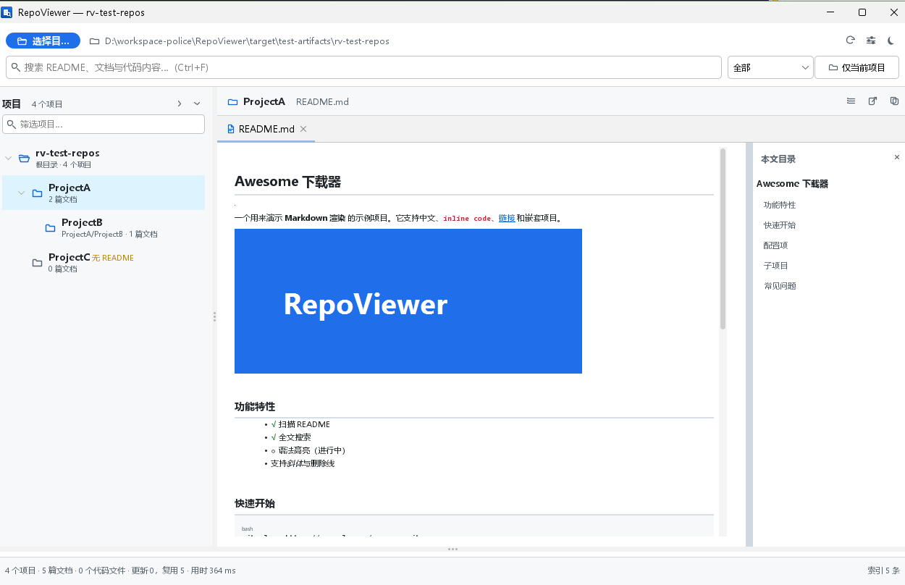
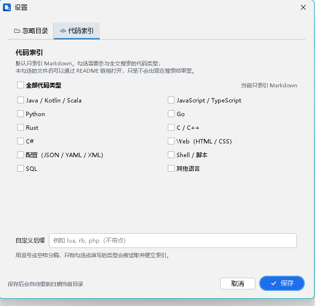

<p align="right"><a href="README.md">English</a> | <b>简体中文</b></p>

# RepoViewer

把散落在本地磁盘上的仓库，变成一个可以像 GitHub 一样翻阅的书架。

选择一个大目录 → 自动发现其中所有带 `README.md` 的项目（支持项目套项目）→ 左侧项目树浏览、右侧阅读 Markdown、顶部全文搜索文档和代码。

默认只索引 Markdown；需要搜代码时，在设置里按语言勾选 Java、JavaScript、Python、Go、Rust、C++ 等类型即可，保存后自动重新扫描。



<sub>首次启动的欢迎页：`docs/screenshot-welcome.png`</sub>

## 功能

### 项目发现

- 递归扫描，默认跳过 `node_modules`、`target`、`build`、`dist`、`.git`、`.svn`、`vendor`、`__pycache__` 等目录；这份忽略列表可以在设置里自由增删。
- 目录里有 `README.md`（大小写不敏感，兼容 `readme.markdown`）即视为项目。
- 没有 README、但有 `pom.xml` / `package.json` / `go.mod` / `.git` 等构建标记的目录也会保留，并标注“无 README”。
- 嵌套项目不截断：项目 A 里的项目 B 会作为 A 的子节点展示。
- 文件归属最近的祖先项目；`node_modules` 里的 README 不会被误收。

### Markdown 阅读（GitHub 风格）

- commonmark + GFM 表格 / 删除线 / 自动链接 / 任务列表。
- 纯 Java 渲染（commonmark → Swing HTML，不依赖 webview / 浏览器运行时）。
- Windows 下启用 LCD 子像素抗锯齿，Markdown 与代码区都关闭分数度量，小字号更清晰。
- 右侧自动生成文档目录，点击跳转；标题同时生成 `h-N` 和 GitHub 风格 slug 锚点。
- 代码块带底色和语言标签，表格、引用块、任务列表都有独立样式。
- 相对链接、文内锚点、本地图片（自动按栏宽缩放）都能直接打开 / 显示。
- 支持浅色 / 深色主题，Markdown 与代码阅读器同步切换。

### 全文搜索

- Lucene 增量索引：文件指纹没变就跳过，重复扫描很快。
- 中文按“大小写不敏感的子串”匹配，不依赖分词；英文支持多关键词 AND，查询词首尾的中英文标点会自动忽略。
- 支持 `*` / `?` 通配符。
- 搜索范围：全部 / Markdown / 代码；代码未启用时显示“代码（未启用）”。
- 默认只索引 Markdown，代码需要先在设置里勾选对应语言类型。
- 结果顶部有“按项目”下拉框，列出**所有命中项目及数量**（不受结果条数截断），选中后只看该项目；README 内容命中会优先展示。
- 点击搜索结果或选择“按项目”下拉项时，左侧项目树会自动展开并定位到对应项目。
- 可勾选“仅当前项目”，只搜索左侧选中的项目（包含子项目）。
- 结果带文件名、所属项目、相对路径、行号和命中片段高亮。
- 单击结果预览，双击固定打开，文档中所有命中会黄色高亮并自动滚到第一处。

### 设置

- 工具栏齿轮按钮或 `Ctrl+,` 打开。
- **忽略目录**：默认已包含 `node_modules`、`dist`、`.git`、`.svn` 等常见目录，可添加、删除、恢复默认；还可以单独控制是否忽略以 `.` 开头的隐藏目录。
- **项目识别深度**：默认只把扫描根目录下 4 层以内的 README 目录识别为项目；更深的 README 仍会作为上级项目的文档参与内容搜索。下载目录特别大时可以调小。
- **代码索引**：默认只索引 Markdown。勾选 Java / JavaScript / Python / Go / Rust / C++ / C# 等语言组，或直接填写自定义后缀；只有被勾选或填写的类型才会被读取、计数并建立索引。
- 保存后自动重新扫描当前目录，索引会同步删除已经不再需要的内容。



### 浏览体验

- 项目树两行渲染：项目名 + 相对路径 / 文档数；支持按名称或路径过滤、展开 / 折叠全部。
- 项目树使用自绘渲染器；项目很多时默认只展开根节点，避免一次铺开几千行，“全部展开”前会确认。
- 单击项目预览做了防抖，方向键快速切换时不会反复渲染 README。
- 标签页区分“预览”和“固定”：单击项目只占一个预览标签，双击或搜索结果打开固定标签。
- 可拖动的文档 / 搜索结果分栏。
- 记住上次目录、窗口位置、主题和分栏位置。
- 快捷键：`Ctrl+O` 选择目录、`F5` 重新扫描、`Ctrl+F` 搜索、`Ctrl+,` 设置、`Ctrl+W` 关闭标签、`Ctrl+1/2/3` 切换搜索范围、`Esc` 清空搜索。

## 运行

要求 JDK 21+、Maven 3.9+。

```bat
mvn clean package
java -jar target\RepoViewer.jar
```

或者直接双击 `run.bat`（jar 不存在时会自动构建）。也可以把目录作为参数传入：

```bat
java -jar target\RepoViewer.jar D:\workspace
```

## 自动发布

`.github/workflows/release.yml` 会构建全部产物并自动发布到 GitHub Release：

- Windows 便携版 `.zip`（jpackage `app-image`，内置 JRE；解压后运行 `RepoViewer.exe`）
- Windows `.exe` 安装包（内置 JRE）
- Linux `.deb` 和 `.rpm` 安装包（内置 JRE）
- macOS `.dmg`（Apple Silicon 与 Intel 各一份，内置 JRE，未签名；首次打开请右键 → 打开）
- 不包含 JRE 的 `RepoViewer-<version>.jar`（需要 Java 21+）

在 **Actions → Release → Run workflow** 输入数字版本号（例如 `1.0.0`）即可，或推送 `v1.0.0` 这样的 tag。流程会先跑测试、构建 shaded jar，再生成各平台安装包，并创建或更新 `v<version>` Release。

内置 JRE 默认按最小化方式打包：用 `jdeps` 检测 shaded jar 实际依赖的模块，再补上 `jdk.charsets`（GB18030）和 `jdk.crypto.ec`（TLS）。手动运行时选择 `full` 则改为完整 Java SE 模块加常用 JDK 模块。

Windows 文件属性中的厂商、文件说明、版权来自打包步骤的 `VENDOR`、`DESCRIPTION`、`COPYRIGHT` 环境变量；`--app-version`（2–4 段数字）会同时写入 `FileVersion` 和 `ProductVersion`，jpackage 无法把这两个版本设成不同值。当前值：厂商 `RepoViewer`、文件说明 “Browse local repositories and search Markdown/code”、版权 “Copyright 2026 RepoViewer”。

## 程序图标

安装包通过 jpackage 的 `--icon` 使用平台对应图标：

| 平台 | 路径 | 格式 |
| --- | --- | --- |
| Windows | `src/main/resources/icon/icon.ico` | ICO（包含 16–256 px 多尺寸） |
| macOS | `src/main/resources/icon/icon.icns` | ICNS |
| Linux | `src/main/resources/icon/icon.png` | PNG，1024×1024 |

替换这三个文件即可换成自己的图标。Swing 运行时窗口图标由 `UiKit.appImage` 单独绘制。

## 目录结构

```
src/main/java/com/repoviewer/
├── RepoViewerApp.java          程序入口：主题、窗口、恢复上次目录
├── AppSettings.java            Preferences 配置（上次目录、主题、窗口、忽略目录、项目深度、代码类型）
├── core/
│   ├── FileTypes.java          扩展名、默认忽略目录、编码探测、二进制判断
│   ├── RepoProject.java        项目模型（父子关系、文档 / 代码清单、README 摘要）
│   ├── ProjectScanner.java     目录扫描与项目识别（忽略目录、代码类型、项目深度）
│   ├── MarkdownRenderer.java   Markdown → Swing HTML（锚点、代码块、链接、图片后处理）
│   └── RepoIndex.java          Lucene 增量索引、检索、搜索片段、项目汇总
└── ui/
    ├── MainFrame.java          主窗口：扫描流程、搜索调度、快捷键、主题切换
    ├── SettingsDialog.java     设置：忽略目录、项目识别深度、代码索引类型
    ├── ProjectTreePanel.java   项目树、过滤、右键菜单
    ├── DocumentViewer.java     阅读区：上下文栏、标签页、欢迎页、项目概览
    ├── MarkdownView.java       Markdown 阅读器 + 目录 + 搜索高亮
    ├── CodeView.java           RSyntaxTextArea 代码查看器
    ├── SearchResultsPanel.java 底部搜索结果 + 按项目筛选
    ├── Theme.java              FlatLaf 主题与调色板
    └── UiKit.java              矢量图标、按钮 / 输入框样式、桌面集成
```

## 二次开发提示

- **新增可搜索的文件类型**：改 `FileTypes.CODE_EXT`（或 `MD_EXT`）；代码类型是否参与索引由设置决定，默认只索引 Markdown。
- **调整忽略目录**：优先用设置界面；默认值在 `FileTypes.DEFAULT_IGNORED_DIRS`。
- **默认代码类型**：`AppSettings.codeExtensions()`（默认空集合），设置界面保存后写入同一处。
- **更换分词 / 搜索策略**：`RepoIndex.buildQuery` 目前是 Wildcard 子串匹配；需要分词、短语、模糊搜索时替换这里即可，索引字段结构不用动。
- **调整 Markdown 样式**：`MarkdownRenderer.Palette`（颜色）与 `wrapHtml` 里的 CSS（字号、标题层级）。
- **增加新的阅读器**：实现一个返回 `JComponent` 的视图，在 `DocumentViewer.openFile` 里按扩展名分流。
- **项目识别规则**：`ProjectScanner.MARKER_NAMES` 决定“无 README 项目”的识别方式；项目深度由设置项控制。

## 数据位置

- 索引：`%USERPROFILE%\.repoviewer\index`
- 配置：Java `Preferences` 节点 `com/repoviewer`（注册表 / `~/.java`），保存上次目录、主题、窗口位置、忽略目录、项目深度、代码索引类型

删除索引目录或清空 Preferences 即可完整重置。索引按扫描根目录隔离，切换根目录时会重建。

## 已知限制

- 远程图片交给 Swing 异步加载；SVG 无法用 ImageIO 渲染，远程 SVG 徽章会被省略，本地 SVG 退化为可点击链接。
- 默认只索引 Markdown；代码文件需要在设置里勾选类型后才会被读取和索引。
- 搜索结果列表最多显示前 1000 条文档，但“按项目”下拉框里的项目数量统计不受此限制。
- 超过“项目识别深度”的 README 不会单独成为项目节点，但内容仍归到上级项目并参与搜索。
- 搜索是子串匹配，不支持正则 / 模糊匹配；代码文件超过 512 KB、文档超过 2 MB 不进入索引。
- 一次只维护一个扫描根目录。
- 不读取 Git 历史，只读取当前工作区文件。

## 依赖

FlatLaf、MigLayout、commonmark-java、Lucene、RSyntaxTextArea。
